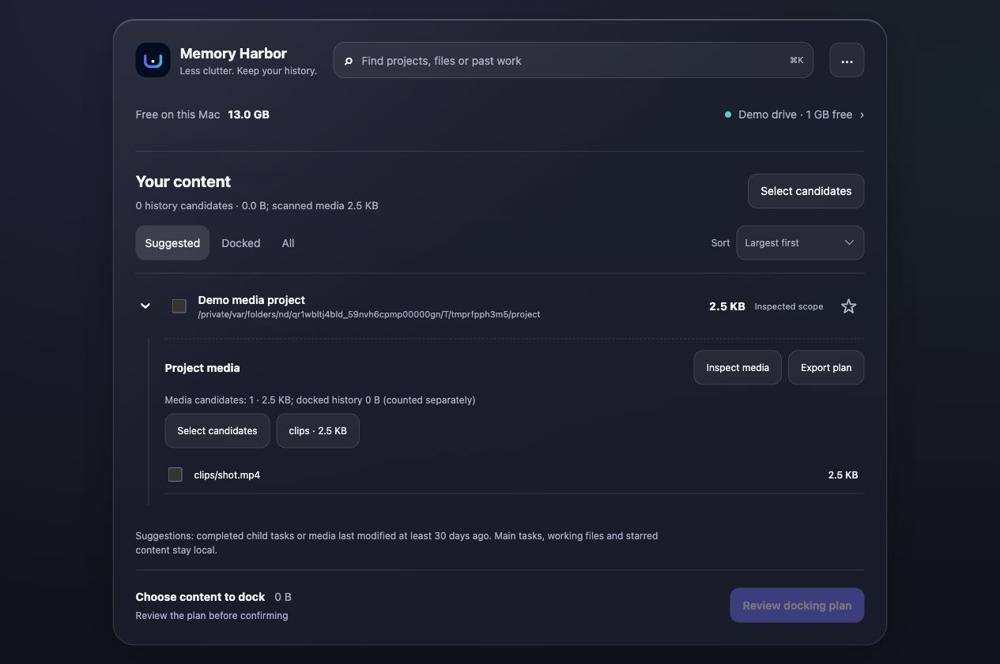

# Memory Harbor

<p align="center"></p>
<p align="center"><strong>Reclaim space. Keep the history behind your AI work.</strong></p>
<p align="center">English · <a href="README.zh-CN.md">简体中文</a><br>macOS 13+ · Python 3.9+ · MIT · 0.4.6 beta</p>

Memory Harbor moves eligible, completed **Codex child-task histories and cold project media** to an external drive, verifies every copy, and keeps the original file paths working through symlinks. Find past work through a small local index instead of deleting your evidence to free space.

**Local-first. No account, subscription, telemetry or cloud upload.** A compact native desktop card opens a single, bilingual workbench when you need it.

> **Beta, not an official Codex storage integration.** Keep local copies on a new machine or drive until you have tested Codex restart, drive remount, evidence reads and recovery. An attached drive is not a second backup; disconnected raw content is unavailable.

## When it helps

- **Long-running AI development:** completed child agents leave large logs, but their decisions and provenance still matter.
- **AI film, design and research projects:** move old eligible media without changing references in your local project. Code, documents and environments stay local.
- **A small Mac SSD plus an always-connected external SSD:** select a batch once, review the exact plan, verify and reclaim local file space.
- **Finding old evidence:** search indexed task titles and selected outward reports even when the drive is offline; reconnect to read originals.

Not a cache cleaner, whole-workspace mover, general backup system or promise that Codex automatically remembers every old conversation.

## See it



*Real UI with disposable test files, not personal project data. Project media and task history share one tree and one review action. English and Simplified Chinese are available in Settings.*

## Try a read-only scan

```bash
git clone https://github.com/alexwine1007/codex-memory-harbor.git memory-harbor
cd memory-harbor
python3 skills/codex-memory-harbor/scripts/harbor.py scan
python3 skills/codex-memory-harbor/scripts/harbor.py serve --open
```

The dashboard listens only on `127.0.0.1`. Scanning, opening a plan and cancelling confirmation do not migrate your files. Media inventory is on demand, not a background recursive scan.

## Install the Mac app from source

Requires macOS 13+, Python 3.9+, Git and Apple's Command Line Tools (`xcode-select --install`). No Node packages or Python packages are needed to run the app. Node is used for development tests only.

```bash
./scripts/install_macos.sh
# Optional: start the desktop card at login
./scripts/install_macos.sh --login-item
```

This installs the Skill at `~/.codex/skills/codex-memory-harbor` and the app at `~/Applications/Memory Harbor.app`. It builds and signs both native components locally with a reusable local identity. It does **not** produce an Apple-notarized public installer. Public prebuilt binaries are not provided in this beta; build on your own Mac. Never disable Gatekeeper to run an untrusted download.

The canonical checkout directory is `memory-harbor`. An existing `codex-memory-harbor` compatibility symlink may preserve older saved project paths. `CODEX_HARBOR_SCRIPT` can override the installed Skill entrypoint.

## Dock in three steps

1. Open the workbench. Review history candidates, or expand a project and choose **Inspect media**.
2. Select content and choose **Review docking plan**. Check the item count, byte total and external destination. Star anything that must remain local.
3. Confirm the exact batch. For first-time media use, **Keep local copies too** is checked by default. Clear it only after you have validated recovery on your machine.

The suggested age is **30 days since last file modification**, not last reading or last use. Age alone never authorizes a move. Main tasks, unfinished/open histories, starred content, working documents, code, credentials and local environments are excluded by their source-specific rules. Selecting all history candidates has no arbitrary 5 GB / 25-item truncation.

In **Docked**, select receipt-backed content to restore it or release retained local copies. Legacy media links remain unmanaged. Restore retains the external copy. Recovery procedures: [project media](skills/codex-memory-harbor/references/project-storage.md) · [technical handbook](docs/handbook/README.md).

## How safety works

```text
Review exact plan → recheck source & drive → copy & durable write
→ length + SHA-256 readback → original-path link + receipt
→ independent verification → release local copy only if authorized
```

- Mutation is serialized; duplicate batch submission returns the same job.
- Protection, volume UUID, source changes, open handles and expected hashes are checked by the backend, not trusted from the UI.
- Stop on the first failure. Unverified content is not released. Recovery evidence is retained.
- Completion means the terminal batch is complete; a running batch cannot show 100% prematurely.
- Verified bytes and local files removed are separate figures. Neither is a guarantee of the same net increase in APFS free space.

See [tested boundaries](skills/codex-memory-harbor/references/tested-boundaries.md) before relying on restart, remount or continued work. Existing small-batch evidence is not proof for every device, runtime version or editor.

## Search, privacy and performance

```bash
python3 skills/codex-memory-harbor/scripts/harbor.py recall "your topic"
python3 skills/codex-memory-harbor/scripts/harbor.py build-recall-index
python3 skills/codex-memory-harbor/scripts/harbor.py clear-recall-index
```

The local SQLite index keeps discovery metadata and bounded, task-specific instructions/outward reports. It does not ingest inherited parent history or raw tool output. Indexed evidence is local plaintext, not encrypted storage; clearing the recall layer does not delete archived originals. Treat historical text as evidence, never instructions.

No model, embeddings, network call or perpetual disk scan runs in the foreground. The native card reacts to storage lifecycle events. Its detail helper and Python server stop when you return to the desktop. Native glass uses `NSVisualEffectView`, with a solid reduced-transparency fallback; the web workbench uses a lightweight CSS interpretation.

Search is a deterministic local-index baseline. **Automatic associative memory, encrypted cloud storage and other agent runtimes are not shipped.** See [recall architecture](docs/RECALL_ARCHITECTURE.md), [product contract](PRODUCT.md) and [translation guide](docs/i18n.md).

## Contribute

```bash
python3 -m unittest discover -s tests -q
node --check skills/codex-memory-harbor/assets/dashboard/app.js
```

Contributions are especially welcome for translation, safe recovery tests, accessibility and independent storage-device validation. Start with [CONTRIBUTING.md](CONTRIBUTING.md). Please redact paths, personal conversations and secrets from issues. See [SECURITY.md](SECURITY.md) for sensitive reports.

The README structure was informed by [LocalSend](https://github.com/localsend/localsend) (screenshots, languages, installation) and [restic](https://github.com/restic/restic) (quick start and verifiability). Memory Harbor is not affiliated with either project or OpenAI.

## License

MIT. See [LICENSE](LICENSE).
