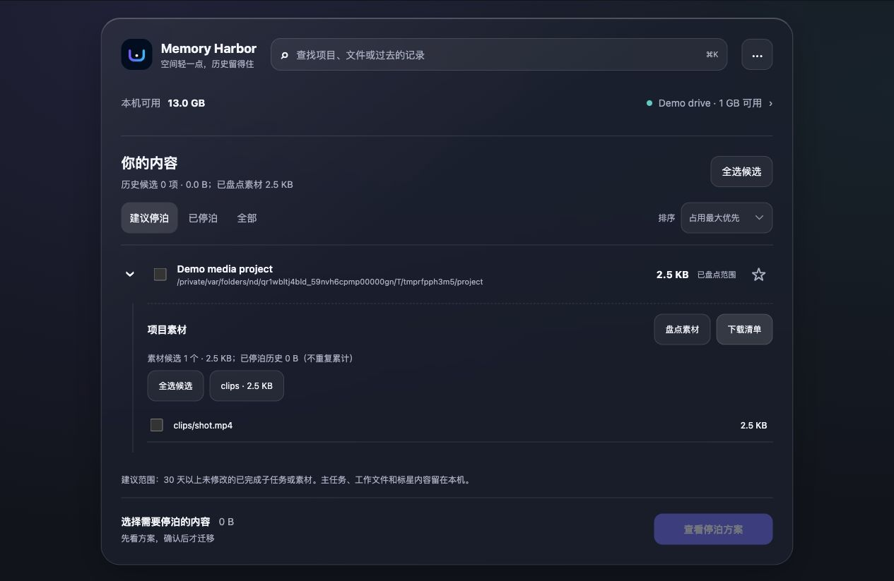

# Memory Harbor · 记忆港

<p align="center"></p>
<p align="center"><strong>空间轻一点，历史留得住。</strong></p>
<p align="center"><a href="README.md">English</a> · 简体中文<br>macOS 13+ · Python 3.9+ · MIT · 0.4.6 beta</p>

记忆港把符合条件的 **Codex 已完成子任务历史和项目冷素材** 停泊到外置硬盘，逐个验证副本，并用符号链接保留原文件路径。腾出空间，同时保留过去工作的证据和出处。

**本地优先，无需账号、订阅、遥测或上传云端。** 桌面小卡片用到时打开同一个工作台，支持中文、英文。

> **测试版，不是 Codex 官方存储接口。** 新机器、新介质请先保留本地副本，分别测试 Codex 重启、硬盘重挂载、读取原始证据与恢复。外挂硬盘不是额外备份；拔盘时原始内容暂时不可读。

## 适合什么场景

- **长期 AI 研发：** 子代理完成任务后留下大量历史，希望留证据而不是直接删除。
- **AI 影视、设计与研究：** 旧素材占空间，希望迁移后项目里的原路径仍可使用，代码、工作文档和环境留在本机。
- **小容量 Mac + 长期外挂 SSD：** 一次选好候选，查看明确方案后确认迁移，校验后释放本机实体。
- **回看历史：** 从本机小索引查找任务标题与部分对外汇报；离线能找到索引，接盘后能读原件。

它不是缓存清理器、整个活跃工作区搬家工具、通用备份系统，也不承诺让 Codex 自动记住所有旧对话。

## 界面



*真实界面，展示的是临时测试文件，不含个人项目数据。历史和素材在同一棵项目树里，共用“查看停泊方案”。语言在右上角设置里切换。*

## 先只读看看

```bash
git clone https://github.com/alexwine1007/codex-memory-harbor.git memory-harbor
cd memory-harbor
python3 skills/codex-memory-harbor/scripts/harbor.py scan
python3 skills/codex-memory-harbor/scripts/harbor.py serve --open
```

服务只监听 `127.0.0.1`。扫描、查看方案、取消确认都不会迁移文件。项目素材只在你点击盘点时扫描，不后台遍历硬盘。

## 从源码安装 Mac App

需要 macOS 13+、Python 3.9+、Git 和苹果命令行开发工具（`xcode-select --install`）。运行不需要 Node 包或第三方 Python 包；Node 仅用于开发测试。

```bash
./scripts/install_macos.sh
# 可选：开机登录后显示桌面卡片
./scripts/install_macos.sh --login-item
```

安装到 `~/Applications/Memory Harbor.app`，Skill 安装到 `~/.codex/skills/codex-memory-harbor`。脚本在自己的 Mac 上编译，并使用可复用本地签名身份签署 App 和 Helper。这不是苹果公证的公开安装包；本 beta 暂不提供预编译下载，请从源码构建，不要为未知下载关闭 Gatekeeper。

## 三步使用

1. 打开就能选内容。看历史候选，或展开项目点击“盘点素材”。
2. 选择后点“查看停泊方案”，核对对象、容量和目的盘。重要项目或任务点星星，长期留本机。
3. 确认这一个明确批次。项目素材默认勾选“同时保留本地副本”；先完成自己机器的恢复验收，再决定取消保留。

默认候选是 **30 天以上未修改**，不是“30 天没打开”。时间只是候选条件，不是迁移授权。主任务、未完成或打开中的历史、标星保护、代码、工作文档、凭据和本机环境按各自规则排除。历史全选不再截断为每次 5 GB 或 25 项。

在“已停泊”里选择有回执的内容，可恢复到本机，或校验后释放单独保留的本地副本。恢复后外盘副本保留。旧素材链接不擅自接管。详见 [项目素材说明](skills/codex-memory-harbor/references/project-storage.md) 与 [技术手册](docs/handbook/README.md)。

## 安全迁移，不等于直接移动

```text
查看明确方案 → 复查来源和卷身份 → 复制并持久写入
→ 长度 / SHA-256 回读 → 原路径链接 / 校验回执
→ 独立复核 → 得到授权后释放本地实体
```

- 后端串行处理，重复提交同一批次返回原任务，不重复删除。
- 保护条件、卷 UUID、来源变化、打开句柄和预期哈希不由前端说了算。
- 第一项失败立即停止；未通过校验不释放，保留可恢复的证据。
- 完成后进度为 100%；还在处理时不会提前满格。
- “已验证容量”和“本次移除的本地文件”分开报告，不冒充 APFS 可用空间净增量。

参考 [已验证边界](skills/codex-memory-harbor/references/tested-boundaries.md)。少量真实测试不是对所有机器、Runtime 版本和编辑器的普遍保证。

## 记忆、隐私和轻量化

```bash
python3 skills/codex-memory-harbor/scripts/harbor.py recall "关键词"
python3 skills/codex-memory-harbor/scripts/harbor.py build-recall-index
python3 skills/codex-memory-harbor/scripts/harbor.py clear-recall-index
```

本机 SQLite 索引保留发现元数据及受限的任务指令、对外汇报，不收录继承的父任务历史和工具原始输出。索引是本地明文，不是加密保险箱；清理召回索引不删除外盘原件。历史只作为证据，不当成当前指令。

正常工作不启动模型、联网或持续扫描磁盘。桌面卡片响应挂载等事件；回到桌面后详情 Helper 和 Python 服务退出。桌面使用系统 `NSVisualEffectView` 毛玻璃，支持减少透明度；网页使用轻量 CSS 玻璃效果。

**自动联想召回、加密云存储、其他 Agent Runtime 尚未交付。** 查看 [召回路线](docs/RECALL_ARCHITECTURE.md)、[产品合同](PRODUCT.md) 与 [多语言贡献说明](docs/i18n.md)。

## 一起完善

```bash
python3 -m unittest discover -s tests -q
node --check skills/codex-memory-harbor/assets/dashboard/app.js
```

欢迎翻译、恢复测试、可访问性和独立存储介质验收贡献。先读 [CONTRIBUTING.md](CONTRIBUTING.md)，问题反馈中不要上传私人对话、凭据或未脱敏路径；敏感问题参见 [SECURITY.md](SECURITY.md)。

首页结构参考 [LocalSend](https://github.com/localsend/localsend) 的截图、多语言和安装入口，以及 [restic](https://github.com/restic/restic) 的快速开始与可验证性说明；本项目与它们及 OpenAI 无隶属关系。

## 许可证

MIT，见 [LICENSE](LICENSE)。
